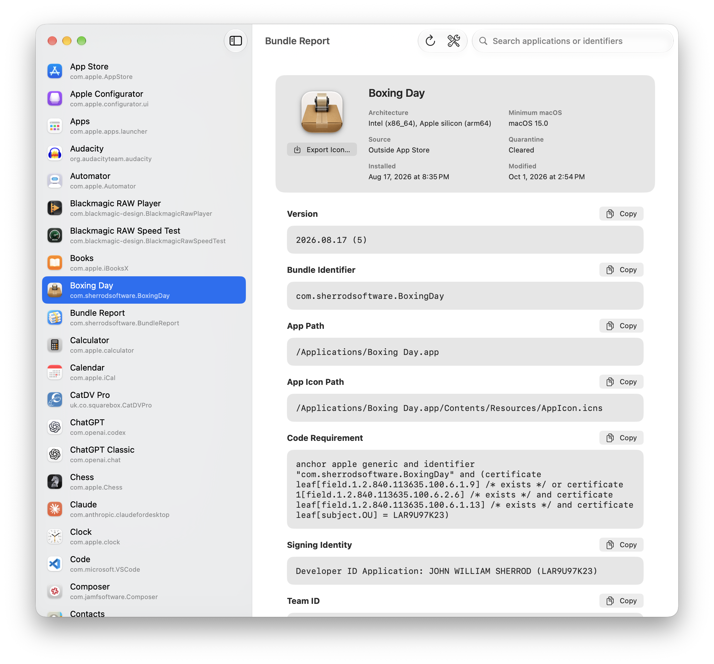

<h1>
  
  Bundle Report
</h1>

A small open-source macOS utility for quickly inspecting an installed app's
identity, deployment details, and code-signing information. Search the apps on
your Mac, then review and copy the details you need—no Terminal required.

  

## What it does

1. **Finds standard application bundles** in `/Applications`,
   `/System/Applications`, and `~/Applications`.
2. **Lists each app with its Finder icon, name, and bundle identifier** so the
   information is easy to identify at a glance.
3. **Searches by application name or bundle identifier**, making it quick to
   locate a specific app in a long list.
4. **Summarizes deployment details** including architecture, minimum macOS,
   install and modification dates, distribution source, and quarantine status.
5. **Shows and copies key identifiers and paths**: version and build number,
   bundle identifier, application path, and app icon path.
6. **Exports the selected app's icon** as a PNG file.
7. **Reads the designated code requirement, signing identity, and Team ID**
   directly from macOS's code-signing services.
8. **Copies only on request.** Each available detail has its own Copy button;
   selecting an app never overwrites the clipboard.
9. **Reveals or opens the selected app** directly from Bundle Report.
10. **Keeps Utility apps hidden by default** to keep the list focused. Turn on
   **Show Utility Apps** whenever you need to include them.
11. **Works from either the main window or the menu bar**, so the app is close
   at hand during policy, scripting, support, or device-management work.

## Requirements

- macOS 15 or later (Mac-only app — no iOS/iPadOS/visionOS target)

## Security

Please see [SECURITY.md](SECURITY.md) for responsible vulnerability reporting.

## License

Bundle Report is available under the [MIT License](LICENSE.md).
