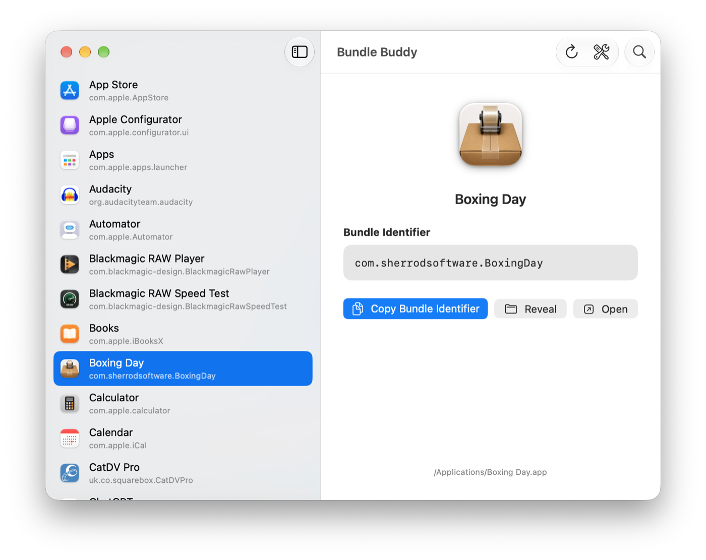

# Bundle Buddy

  

Bundle Buddy is a quick, native macOS utility for finding an app’s bundle identifier—without opening Terminal.

Search your installed applications, select one, and copy its identifier when you are ready. It is particularly handy for device-management, policy, scripting, and support workflows.

  

## Features

- Browse installed apps with their names and Finder icons.
- Search by app name or bundle identifier.
- Copy an identifier only when you click **Copy Bundle Identifier**—Bundle Buddy never changes your clipboard simply because you selected an app.
- Reveal the selected app in Finder or open it directly from the detail view.
- Access the same workflow from the app window or the menu bar.
- Keep Utility apps out of the main list by default; turn on **Show Utility Apps** whenever you need them.

## How to use it

1. Open Bundle Buddy from Applications or the menu bar.
2. Search for or select an application.
3. Confirm the displayed bundle identifier.
4. Click **Copy Bundle Identifier** to place it on your clipboard.

## Where Bundle Buddy looks

Bundle Buddy looks in the standard macOS application locations:

- `/Applications`
- `/System/Applications`
- `~/Applications`

Apps within the Utilities folders are available through the **Show Utility Apps** toggle.

## Requirements

- macOS 15.0 or later

## Installation

Download `BundleBuddy.pkg` from the latest release, open it, and follow the installer prompts. Bundle Buddy installs in your Applications folder.

## Privacy

Bundle Buddy reads application metadata stored locally on your Mac. It does not transmit information anywhere, and it copies a bundle identifier only after you explicitly ask it to.
